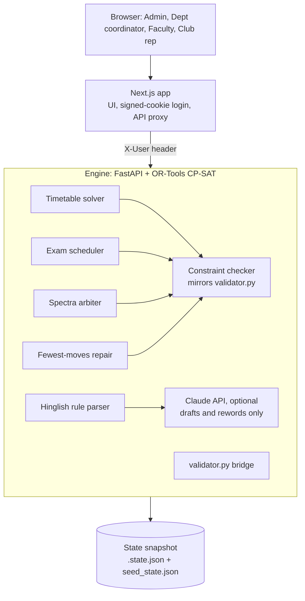

# CrunchWeek

**One clash-proof schedule for Chilika Institute of Technology.** CrunchWeek generates the weekly timetable and the midsem exams, decides every Spectra '27 venue request by the priority rules, repairs the timetable after last-minute changes with the fewest possible moves, and lets people ask for rooms in plain English or Hinglish. Every decision is made by code (OR-Tools CP-SAT and a deterministic arbiter) and every export is checked by the organisers' `validator.py`. AI only drafts requests and rewords explanations.

## Results on `cit_public.json` (official validator)

| File | Hard violations | Soft penalty | Bookings | Exams | Stability |
| --- | --- | --- | --- | --- | --- |
| `exports/schedule.json` | **0** | 3 (only S4: three 5 pm classes) | 67/70, 0 priority inversions | penalty 0 | |
| `exports/schedule_after.json` (sample disruption) | **0** | 3 | 67/70 | penalty 0 | 8 sessions moved, all room-only, 0 time changes |

Full validator output: `exports/validator_schedule.txt`, `exports/validator_schedule_after.txt`. Regenerate with `python engine/scripts/make_exports.py`.

## What makes it different

- **Spectra-aware timetable.** The solver knows the fest requests while it builds the regular week, and keeps the venues that higher-priority events need free, so the arbiter rarely has to move a class.
- **Fewest-moves repair.** After a change, the solver keeps every untouched class where it was, prefers moving only the room, and shows the exact before/after diff. If no valid timetable exists it says why (for example, a teacher's remaining hours can't fit their load).
- **Every decision explains itself.** "Why is my class at 8 am?" lists what rules out each other time; every Spectra decision names who took the room and why ("SH-1 went to Quiz Club (BR-06), who has priority or asked first").
- **Hinglish requests.** "kal shaam 6 se 8 baje robotics demo, 120 log, projector chahiye" becomes a structured request with stated assumptions, then a live preview of exactly what the arbiter would decide, before anything is sent.
- **Approval routing, no self-approval.** Club and faculty requests go to a department coordinator or admin; admin requests need a different admin; disruptions need an admin.
- **The judges' validator is built in.** The Overview page runs `validator.py` on the live exports.

## Architecture



| Engine module | Job |
| --- | --- |
| `checker.py` | Hard rules H1–H14 and soft score S1–S6, same results as `validator.py` (tested) |
| `solver.py` | CP-SAT timetable (about 90k variables, OPTIMAL in ~30 s), Spectra reservations, baseline-aware repair |
| `exams.py` | CP-SAT midsem exams with half-capacity room packing |
| `arbiter.py` | Priority-first Spectra decisions with role caps, alternatives and Week-7-only class moves for institute events |
| `repair.py` | Applies change files with the validator's semantics, re-solves with fewest moves, diagnoses infeasibility |
| `explain.py` | "Why here?", valid alternatives for a class, room utilisation |
| `nlp.py`, `ai.py` | Rule-based English/Hinglish parser; optional Claude structured output, validated field by field |
| `main.py`, `state.py` | API, approvals, audit log, exports |

## Demo accounts

Sign in on the login page with one click (no password; this is a demo build).

| Account | Role | Try this |
| --- | --- | --- |
| `admin` (Registrar's Office) | Admin | Changes → Load the sample disruption → Work out the smallest fix → Approve. Overview then shows both validator reports. |
| `dean` (Dean, Student Affairs) | Admin | Approves requests the other admin made |
| `coord.cse` | Department coordinator | Spectra week → approve the club's new request; propose moving a CSE class from the timetable side panel |
| `F01` (Dr. Ananya Mishra) | Faculty | Changes → "I can't take Tuesday mornings" → Check the impact |
| `club.robotics` (Robotics Club) | Club rep | Book a venue → pick the Hinglish example → Send for approval |

Admin → Overview → **Reset demo** restores the seeded timetable in about a second.

## Setup

Requirements: Node 22+, Python 3.11+.

```bash
# 1. Engine
cd engine
python -m venv .venv
source .venv/bin/activate          # Windows: .venv\Scripts\activate
pip install -r requirements-dev.txt
uvicorn app.main:app --port 8000   # loads seed_state.json; delete it to solve from scratch (~45 s)

# 2. Web (new terminal)
cd web
cp ../.env.example .env.local      # set SESSION_SECRET; ENGINE_URL if the engine is elsewhere
npm install
npm run dev
```

Open http://localhost:3000.

- Tests: `cd engine && python -m pytest -q` (12 tests, including validator parity and the full API flow).
- Exports: `cd engine && python scripts/make_exports.py` writes `exports/` and the validator reports.
- AI: set `ANTHROPIC_API_KEY` for the engine to use Claude for parsing and plain-language explanations. Without it (or with `AI_MODE=off`) everything works with the rule-based parser.

## Known limitations

- Engine state is a JSON snapshot on the engine's disk (`engine/.state.json`); the Supabase schema is in `supabase/migrations/` but the engine does not write to it yet.
- Demo login is one click per account; real deployments need institute SSO.
- New venue requests made in the app are not part of `schedule.json`, so the export stays checkable against the original dataset.
- Requests made after decisions are published get the best remaining option; they never bump a published decision.

## Declarations

- AI use: [AI_USAGE.md](AI_USAGE.md)
- Third-party software: [THIRD_PARTY.md](THIRD_PARTY.md)
