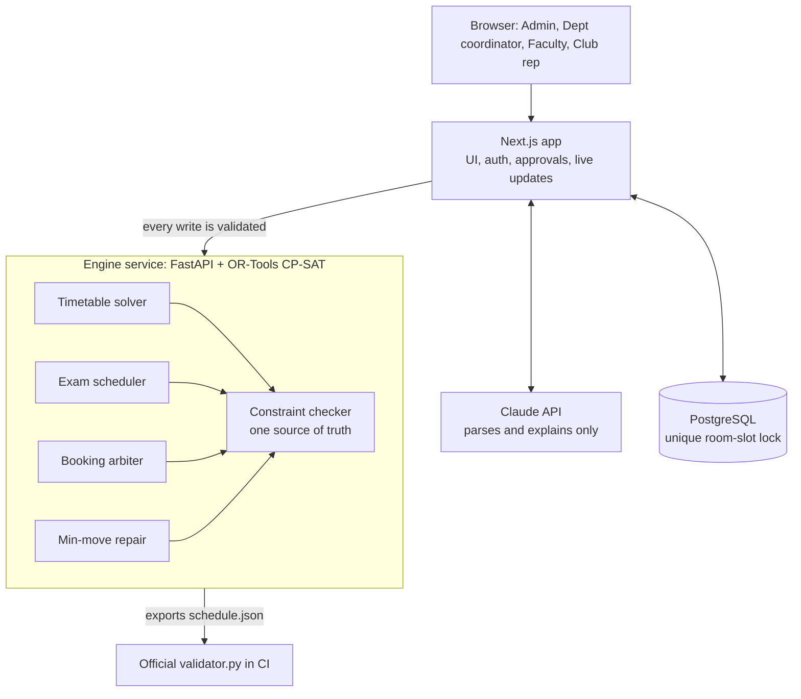

# CrunchWeek

**One clash-proof schedule for Chilika Institute of Technology.** CrunchWeek generates the semester timetable and midsem exams, decides Spectra-week venue requests by the priority rules, repairs the timetable after last-minute changes with the fewest possible moves, and lets people ask for rooms in plain English or Hinglish. Every change, whoever or whatever proposes it, passes one constraint checker before it is saved.

> Status: Phase 0 (project setup). Sections marked *planned* are being built.

## Architecture



## Tech stack

| Layer | Choice |
| --- | --- |
| Web app | Next.js 16 (App Router, TypeScript), Tailwind CSS |
| Engine | Python, FastAPI, Google OR-Tools CP-SAT |
| Database | PostgreSQL (Neon) *planned* |
| AI | Claude API, structured output, validated by the engine *planned* |
| Hosting | Vercel (web), Render (engine) |

## Repository layout

```
web/        Next.js app
engine/     FastAPI engine (checker, solvers, arbiter), validator.py, tests
data/       cit_public.json and starter-pack samples
exports/    schedule.json and schedule_after.json produced by the app
```

## Setup

Requirements: Node 22+, Python 3.11+.

```bash
# 1. Engine
cd engine
python -m venv .venv
source .venv/bin/activate          # Windows: .venv\Scripts\activate
pip install -r requirements-dev.txt
uvicorn app.main:app --reload --port 8000

# 2. Web (new terminal)
cd web
cp ../.env.example .env.local      # set ENGINE_URL if the engine is not on localhost:8000
npm install
npm run dev
```

Open http://localhost:3000. The status panel shows the engine and dataset counts.

Run the tests: `cd engine && python -m pytest -q`.

Check an export with the official validator:

```bash
cd engine
python validator.py --data ../data/cit_public.json --schedule ../exports/schedule.json
```

## Demo accounts

*Planned (Phase 3).* Admin, Department coordinator, Faculty and Club representative accounts will be listed here.

## Known limitations

- Phase 0: only the status page and engine health/dataset endpoints exist.
- Engine state is in memory until the database lands in Phase 3.

## Declarations

- AI use: [AI_USAGE.md](AI_USAGE.md)
- Third-party software: [THIRD_PARTY.md](THIRD_PARTY.md)
