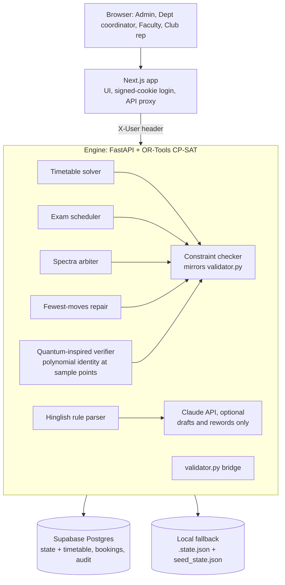

# CrunchWeek

**One clash-proof schedule for Chilika Institute of Technology.** CrunchWeek generates the weekly timetable and the midsem exams, decides every Spectra '27 venue request by the priority rules, repairs the timetable after last-minute changes with the fewest possible moves, and lets people ask for rooms in plain English or Hinglish. Every decision is made by code (OR-Tools CP-SAT and a deterministic arbiter) and every export is checked by the organisers' `validator.py`. AI only drafts requests and rewords explanations.

## Results on `cit_public.json` (official validator)

| File | Hard violations | Soft penalty | Bookings | Exams | Stability |
| --- | --- | --- | --- | --- | --- |
| `exports/schedule.json` | **0** | **3, proven minimum** (S4 only, see below) | **67/70, proven maximum**, 0 priority inversions | penalty 0 | |
| `exports/schedule_after.json` (sample disruption) | **0** | 6 | 67/70 | penalty 0 | 12 sessions moved, the proven minimum (11 room-only, 1 time change) |

### Why nobody can beat 3 and 67

- **Soft penalty 3 is forced by the data.** CS204 has 3 lectures for CSE-2, all taught by F08 (Prof. Vikram Rao, visiting), who can only teach on Tuesday and Thursday. Three lectures on two days puts two on one day, and S4 charges 3 points for that. Every other soft rule is at 0. CP-SAT independently proves 3 optimal.
- **Booking score 67 of 70 is the ceiling.** BR-09 needs 1,200 seats and the largest venue holds 800 (it must be rejected, -2). BR-17 asks for 10 pm to midnight, past the campus day, so it can only get an alternative (half of 2, -1).
- **Repair moves equal the lower bound.** Every class whose room or teacher became unavailable has to move; the repair moves exactly those, and nothing else.

The app's **Proof** page computes these bounds from the data (nothing is hard-coded) and shows them next to what we achieve.

### What the validator doesn't score, and we still optimise

The timetable is solved in three stages, each locking the ones before, so later stages can never cost a validator point:

1. Soft penalty (proved optimal), with Spectra venue slots kept free as the tie-break.
2. Spread classes over rooms, so closing any one shared room forces as few moves as possible.
3. A kinder week: no 8 am starts (16 before, 0 now), no building changes between back-to-back classes (68 before, 0 now), and a spare suitable room at every hour.

A **surprise check** tries every single-room closure and every teacher-day absence on the plan and reports how many can be fixed without touching any other class.

On 10 random disruptions in the judges' format (a teacher away for a day, a classroom closed all week, an added tutorial), the three-stage timetable needed 7 time changes in total against 11 before, and its soft penalty after the fix was 36 in total against 44, with no single closure moving more than 12 classes (19 before). It moved 108 classes in total against 88, all but 7 of them room-only. On the public sample disruption specifically it moves 12 (the proven minimum for this plan), because 11 classes sit in the room that closes.

Full validator output: `exports/validator_schedule.txt`, `exports/validator_schedule_after.txt`. Regenerate with `python engine/scripts/make_exports.py`.

## What makes it different

- **Spectra-aware timetable.** The solver knows the fest requests while it builds the regular week, and keeps the venues that higher-priority events need free, so the arbiter rarely has to move a class.
- **Fewest-moves repair.** After a change, the solver keeps every untouched class where it was, prefers moving only the room, and shows the exact before/after diff. If no valid timetable exists it says why (for example, a teacher's remaining hours can't fit their load).
- **Every decision explains itself.** "Why is my class at 8 am?" lists what rules out each other time; every Spectra decision names who took the room and why ("SH-1 went to Quiz Club (BR-06), who has priority or asked first").
- **Hinglish requests.** "kal shaam 6 se 8 baje robotics demo, 120 log, projector chahiye" becomes a structured request with stated assumptions, then a live preview of exactly what the arbiter would decide, before anything is sent.
- **Approval routing, no self-approval.** Club and faculty requests go to a department coordinator or admin; admin requests need a different admin; disruptions need an admin.
- **Quantum-inspired verifier.** Proves the whole week is clash-free in one pass, in milliseconds. Every busy hour becomes a token, and the tokens and the planner's certificate are encoded as polynomials and compared at 8 independent sample points. A planted clash is caught and located on the spot. See [docs/QUANTUM_VERIFIER.md](docs/QUANTUM_VERIFIER.md).
- **The judges' validator is built in.** The Overview page runs `validator.py` on the live exports.

## Architecture



| Engine module | Job |
| --- | --- |
| `checker.py` | Hard rules H1–H14 and soft score S1–S6, same results as `validator.py` (tested) |
| `solver.py` | Three-stage lexicographic CP-SAT timetable (about 90k variables; soft penalty OPTIMAL in ~50 s on 4 cores), Spectra reservations, baseline-aware repair |
| `proofs.py` | Lower and upper bounds for every validator score, with plain-words reasons |
| `resilience.py` | Surprise check over every room closure and teacher-day absence; student-week measures |
| `exams.py` | CP-SAT midsem exams with half-capacity room packing |
| `arbiter.py` | Priority-first Spectra decisions with role caps, alternatives and Week-7-only class moves for institute events |
| `repair.py` | Applies change files with the validator's semantics, re-solves with fewest moves, diagnoses infeasibility |
| `qverify.py` | Quantum-inspired verifier: busy-hour tokens, ordered certificate, polynomial identity over GF(2^61−1) at 8 sample points, clash location ([details](docs/QUANTUM_VERIFIER.md)) |
| `explain.py` | "Why here?", valid alternatives for a class, room utilisation |
| `nlp.py`, `ai.py` | Rule-based English/Hinglish parser; optional Claude structured output, validated field by field |
| `main.py`, `state.py` | API, approvals, audit log, exports |

## Demo accounts

Sign in on the login page with one click (no password; this is a demo build).

| Account | Role | Try this |
| --- | --- | --- |
| `admin` (Registrar's Office) | Admin | Changes → Load the sample disruption → Work out the smallest fix → Approve. Overview then shows both validator reports. |
| `dean` (Dean, Student Affairs) | Admin | Approves requests the other admin made |
| `coord.cse` | Department coordinator | Spectra week → approve the club's new request; propose moving a CSE class from the timetable side panel |
| `F01` (Dr. Ananya Mishra) | Faculty | Changes → "I can't take Tuesday mornings" → Check the impact |
| `club.robotics` (Robotics Club) | Club rep | Book a venue → pick the Hinglish example → Send for approval |

Admin → Overview → **Reset demo** restores the seeded timetable in about a second.

## Setup

Requirements: Node 22+, Python 3.11+.

```bash
# 1. Engine
cd engine
python -m venv .venv
source .venv/bin/activate          # Windows: .venv\Scripts\activate
pip install -r requirements-dev.txt
uvicorn app.main:app --port 8000   # loads seed_state.json; delete it to solve from scratch (about 2 to 3 minutes)

# 2. Web (new terminal)
cd web
cp ../.env.example .env.local      # set SESSION_SECRET; ENGINE_URL if the engine is elsewhere
npm install
npm run dev
```

Open http://localhost:3000.

### Database (Supabase)

1. Supabase dashboard > SQL Editor > New query: paste `supabase/migrations/0002_engine_store.sql` and Run. It is safe to run again.
2. Supabase dashboard > Connect > **Session pooler**: copy the connection string and put it in `engine/.env` as `DATABASE_URL=...`, with `[YOUR-PASSWORD]` replaced by the database password. `engine/.env` is git-ignored.
3. `pip install -r requirements.txt` again (adds `psycopg`), then start the engine as above.

On start the engine loads its state from Supabase (or, the first time, uploads the seeded timetable). Every change is then saved to `engine_state` and mirrored into tables you can query: `rooms`, `class_sessions`, `timetable_slots`, `room_occupancy`, `venue_requests`, `venue_bookings`, `exam_placements`, `change_requests`, `audit_log`. Postgres itself refuses clashes: one occupant per room per period, one class per teacher and per student group per period, one exam per room per slot, and no overlapping venue bookings (an exclusion constraint). `GET /health` shows the database status, and `select mirror_ok, mirror_error from engine_state` shows the last sync result.

- Tests: `cd engine && python -m pytest -q` (12 tests, including validator parity and the full API flow).
- Exports: `cd engine && python scripts/make_exports.py` writes `exports/` and the validator reports.
- AI: set `ANTHROPIC_API_KEY` for the engine to use Claude for parsing and plain-language explanations. Without it (or with `AI_MODE=off`) everything works with the rule-based parser.

## Known limitations

- Without `DATABASE_URL` the engine keeps its state only in `engine/.state.json` on its own disk.
- Demo login is one click per account; real deployments need institute SSO.
- New venue requests made in the app are not part of `schedule.json`, so the export stays checkable against the original dataset.
- Requests made after decisions are published get the best remaining option; they never bump a published decision.

## Declarations

- AI use: [AI_USAGE.md](AI_USAGE.md)
- Third-party software: [THIRD_PARTY.md](THIRD_PARTY.md)
