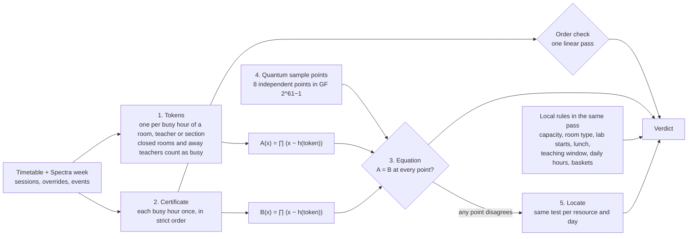

# Quantum-inspired verifier

CrunchWeek proves that a finished week has no clashes in one pass. It does not compare classes two by two. Every room, teacher and section is checked, along with every closed room, every teacher's unavailable hours and every approved Spectra event.

- **Code:** `engine/app/qverify.py`
- **API:** `GET /verify?week=regular|spectra` and `GET /verify?plant=true`
- **UI:** the Verifier card on the Files page

## Architecture

## The steps

1. **Tokens.** Every hour that a room, teacher or section is busy becomes one token, such as `(room, LH-1, MON, 3)`.
   - A room's closed hours and a teacher's unavailable hours are added as tokens too, so a class placed there collides with them.
   - A section shares one token per elective basket, because parallel basket classes are allowed.
   - In Spectra week, an approved event adds tokens for its room and for every section and teacher attending it.
2. **Certificate.** The planner claims each busy hour exactly once, in strict order. One linear pass confirms that order, so a repeat can't hide in the claim.
3. **Equation.** "The week is clash-free" is the same as "the tokens and the certificate are the same multiset". Both sides are encoded as polynomials over the field of the Mersenne prime 2^61 − 1:
   - `A(x) = ∏ (x − h(t))` over all tokens
   - `B(x) = ∏ (x − h(t))` over the certificate

   Identical multisets give identical polynomials.
4. **Quantum sample points.** A and B are compared at 8 independent sample points.
   - A clash-free week always passes.
   - If anything collides, A and B are different polynomials of degree n. They can agree on at most n of the 2^61 − 1 field values.
   - So each point lets a wrong week through with probability at most n / (2^61 − 1). All 8 points together allow at most (n / (2^61 − 1))^8.
   - For this dataset (928 busy hours in Spectra week), that is below 10^-123.
5. **Locate.** When any point disagrees, the same test runs on each resource-and-day slice and names the exact room, teacher or section that is double-booked.

Local rules are per-class facts, so they are checked directly in the same pass:

- capacity
- room type
- accessibility
- labs starting at P2 or P6
- no class over lunch
- the teaching window
- fixed slots
- daily teaching hours
- basket alignment

## Results on cit_public.json

| | |
| --- | --- |
| Spectra week | clash-free, 8 of 8 sample points agree, 928 busy hours, about 8 ms |
| Planted clash (`/verify?plant=true`) | caught at every point, and located as the room, section and teacher booked twice |

## How it is tested (`engine/tests/test_qverify.py`)

- The generated regular week and Spectra week pass.
- A planted room clash and a planted teacher clash are both caught and located.
- A dishonest certificate is rejected, whether it lists a repeated hour (the order check fails) or drops an hour (the equation fails).
- On 300 random class moves, the verifier's verdict matches the deterministic constraint checker every time. That checker mirrors the organisers' `validator.py`.

The organisers' `validator.py` stays the judge of record and runs on the same live exports from the Files page. The verifier is our own code. No LLM takes part in it.
